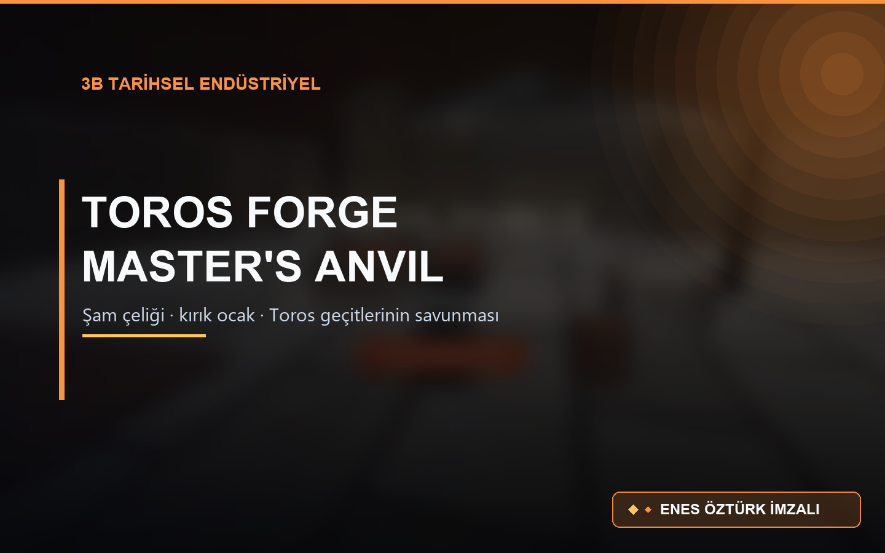
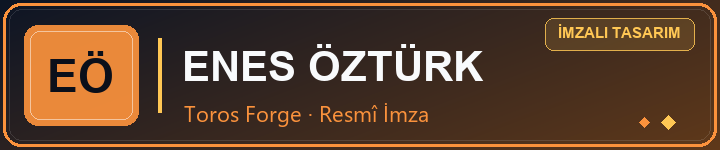
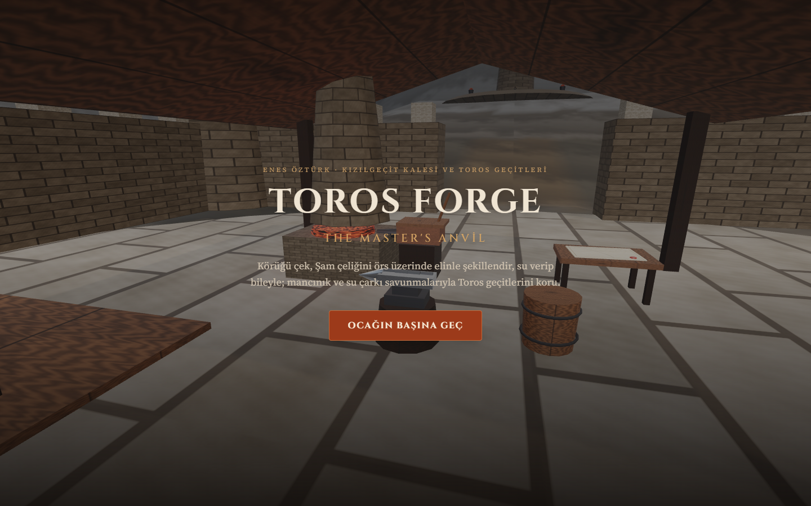
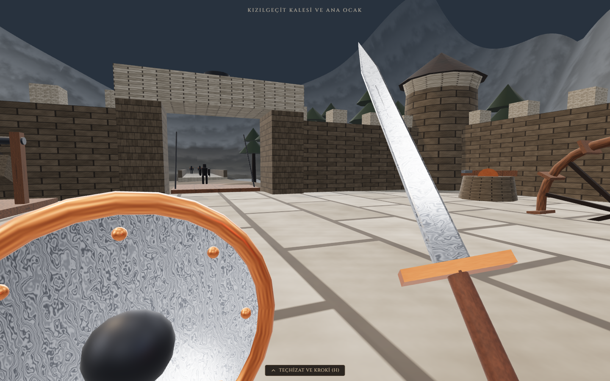

<div align="center">



# Toros Forge: The Master's Anvil

**Enes Öztürk imzalı; Şam çeliğini örste dövüp su verdiğiniz, mancınık ve su çarkıyla Kızılgeçit'i savunduğunuz 3B tarihsel-endüstriyel demircilik deneyimi.**

[](https://github.com/EnesBinMalik/toros-forge-masters-anvil)
[](https://react.dev/)
[](https://www.typescriptlang.org/)
[](https://threejs.org/)
[](https://vite.dev/)

[](https://github.com/EnesBinMalik)
[](https://github.com/EnesBinMalik/toros-forge-masters-anvil)
[](https://github.com/EnesBinMalik/toros-forge-masters-anvil)
[](https://github.com/EnesBinMalik/toros-forge-masters-anvil)



</div>

---

## Hakkında

**Toros Forge: The Master's Anvil**, Kızılgeçit Kalesi'nin ana ocağında geçen, el emeğiyle çelik dövme ve kale savunmasını tek bir zanaatta birleştiren bir deneyimdir. Körüğü çekip kor ocağını harlar, Şam çeliğini örs üzerinde çekiçle şekillendirir, su fıçısına daldırıp bileylersiniz.

Ürettiğiniz usta işi kılıç, kalkan ve baltalarla Toros geçitlerini kuşatmaya karşı savunursunuz. Su çarkı dişlilerini ve ok atarları onarır, mancınık mevzilerini hazırlar, parşömen savunma krokisini (`M`) her an yanınızda taşırsınız. Ekranda yapay bir can çubuğu yoktur; her şey demirci teçhizatının kendisinde okunur. Sahne, dokular ve sesler sıfırdan **Three.js** ile üretilmiştir.

> Bu proje **Enes Öztürk** tarafından tasarlanmış, geliştirilmiş ve imzalanmıştır.

---

## Öne çıkan özellikler

| Özellik | Açıklama |
| --- | --- |
| **Usta işi dövme** | Kor ocağında ısıtılan Şam çeliğini örste çekiçle şekillendirme. |
| **Su verme ve bileme** | Kızgın çeliği suya daldırıp temperleyerek dayanıklılık kazandırma. |
| **Üç silah sınıfı** | Dengeli kılıç+kalkan, zırh kırıcı örs dövme ve ağır savaş baltası. |
| **Mancınık ve su çarkı** | Savunma mekanizmalarını onarıp kuşatmaya karşı çalıştırma. |
| **Parşömen kroki** | `M` ile el yazması savunma haritasını açıp cepheyi inceleme. |
| **Kalkan ve parry** | Sağ tık / `Q` ile gelen darbeleri karşılayıp savunma yapma. |
| **Sedir kerestesi** | Toros sedirlerinden kereste toplayıp kale ve mancınıkları güçlendirme. |
| **Diegetik arayüz** | Ocak sıcaklığı ve çelik durumu doğrudan teçhizat üzerinde okunur. |

---

## Kızılgeçit cepheleri

| # | Bölge | Öne çıkan yapı |
| --- | --- | --- |
| 01 | Kızılgeçit Kalesi ve Ana Ocak | Demirci atölyesi · su çarkı · surlar |
| 02 | Toros Sedirleri ve Kereste Kampı | Sedir kerestesi · öncü pususu |
| 03 | Derin Kanyon ve Asma Taş Köprü | Zincirli asma köprüyü çevirme |
| 04 | Tarihi Kemer Köprü | Kuşatma hattı ve mancınık mevzileri |
| 05 | Toros Geçitleri Savunma Hattı | Su çarkı dişlileri ve ok atarlar |

Her bölge kendi fizik kuralları, ışıklandırması, dokusu ve akustik karakteriyle ayrı bir deneyim sunar.

---

## Kontroller

| Tuş | Aksiyon |
| --- | --- |
| `W` `A` `S` `D` / `Shift` | Yürüme / koşma |
| `Sol tık` / `F` | Savurma ve çekiçle dövme |
| `Sağ tık` / `Q` | Kalkan ve parry |
| `E` | Etkileşim (ocak, örs, su fıçısı, onarım) |
| `M` | Parşömen savunma krokisi |
| `V` | Kamera modu |
| `H` | Arayüzü gizle |

> Oyun sırasında arayüz tamamen kaldırılabilir: ekranda yalnızca dünya içi telemetri kalır.

---

## Galeri






---

## Kurulum

**Gereksinimler:** Node.js 20+ ve modern bir WebGL tarayıcı.

```bash
git clone https://github.com/EnesBinMalik/toros-forge-masters-anvil.git
cd toros-forge-masters-anvil
npm install
npm run dev
```

Uygulama varsayılan olarak `http://localhost:3000` adresinde açılır.

> Oyun tamamen istemci tarafında çalışır; `.env.example` yalnızca AI Studio dağıtım şablonu içindir.

Diğer komutlar:

```bash
npm run build     # Üretim derlemesi (dist/)
npm run preview   # Derlemeyi yerelde önizle
npm run lint      # TypeScript tip kontrolü
```

---

## Teknik mimari

```text
src/engine/TorosEngine.ts      Ana oyun döngüsü ve dövme fiziği
src/engine/worldBuilder.ts     Kızılgeçit cepheleri ve yapılar
src/engine/geometryBuilders.ts Örs, ocak, mancınık ve su çarkı
src/engine/textures.ts         El yapımı tarihsel dokular
src/engine/audio.ts            Ocak, çekiç ve kuşatma sesleri
src/components/GameHud.tsx     Diegetik arayüz ve krokiler
src/components/TitleScreen.tsx Açılış ve imza ekranı
```

---

## İmza

<div align="center">

[](https://github.com/EnesBinMalik)
[](https://github.com/EnesBinMalik)

**Bu kod, tasarım ve deneyim Enes Öztürk'ün kişisel imzasını taşır.**

© 2026 Enes Öztürk — Tüm hakları saklıdır.

</div>
